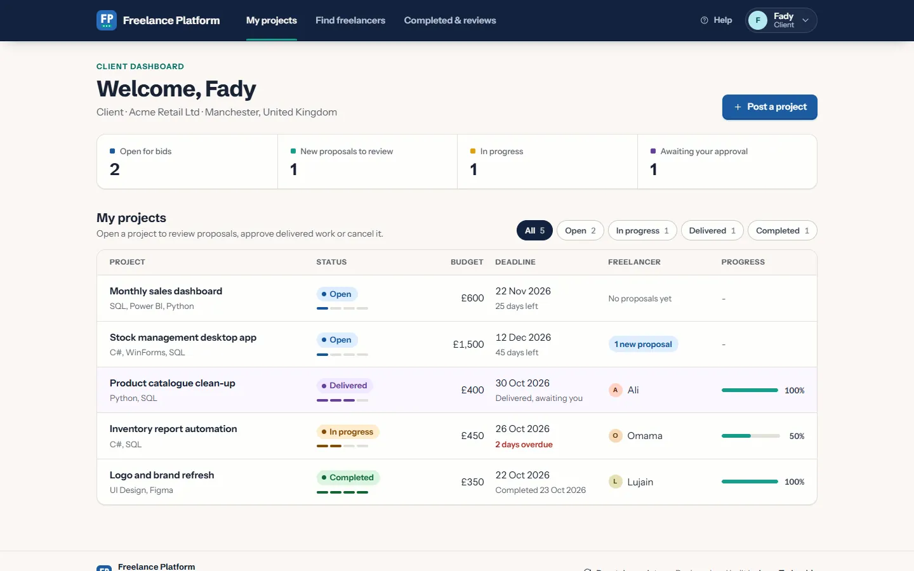
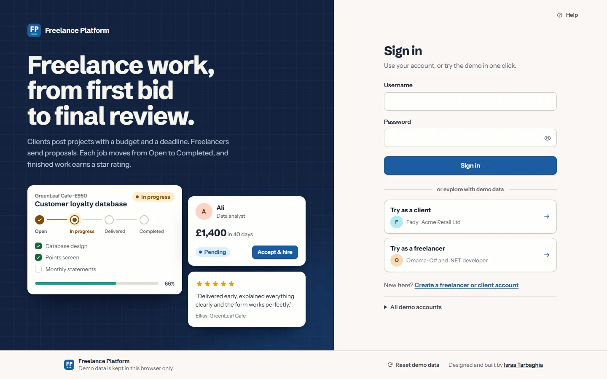

# Freelance Platform

A marketplace where clients post projects and freelancers bid for them. Clients compare proposals, hire, approve the delivered work and leave a review. Freelancers keep a profile and portfolio, bid, and track their milestones and deadlines.

**Try it:** https://israairtirt.github.io/freelance-platform/ (one click to sign in as a demo client or freelancer)

| | |
|---|---|
| Type | Product |
| Built with | HTML, CSS and JavaScript modules, no framework; Web Crypto for password hashing |
| First version | A C# / .NET 8 Windows Forms app, designed with UML class, activity and use-case diagrams |
| Data | Kept in the visitor's browser; "Reset demo data" starts over |

## What it does

- Registration as a client or a freelancer, with a unique username and a password of 8 to 12 letters and numbers including at least one lowercase and one uppercase letter. A checklist ticks off each rule as you type, and the username is checked as you go.
- Clients set up their contact details, post projects with a description, budget, deadline and milestones, read proposals, view freelancers' profiles and hire one.
- Freelancers describe their skills, expertise, portfolio and past work, browse open projects, bid with a price, a delivery time and a cover letter, and tick off milestones.
- Every project moves through Open, In progress, Delivered and Completed (or Cancelled). Each step is checked, so work can't be delivered with milestones still open, and a project can't skip a stage.
- Finished work gets a one-to-five-star review that appears on the freelancer's public profile.
- Help on every screen (F1 or ?), errors shown next to the field they belong to, and empty lists that say what to do next.

## Design

The web version keeps the layers of the desktop app: models, services, security, data and UI. A class hierarchy (entity, user, client, freelancer) sits under services for accounts, projects, bids and reviews, and storage sits behind a data-store interface with a browser store and an in-memory store for tests. Passwords are hashed with PBKDF2-SHA256 and a random salt, the same scheme the desktop app used.

## About this repository

This repository holds the published build that GitHub Pages serves: minified HTML and CSS, and minified, obfuscated JavaScript. The source code is private.

Designed and built by [Israa Tarbaghia](https://israairtirt.github.io/).
